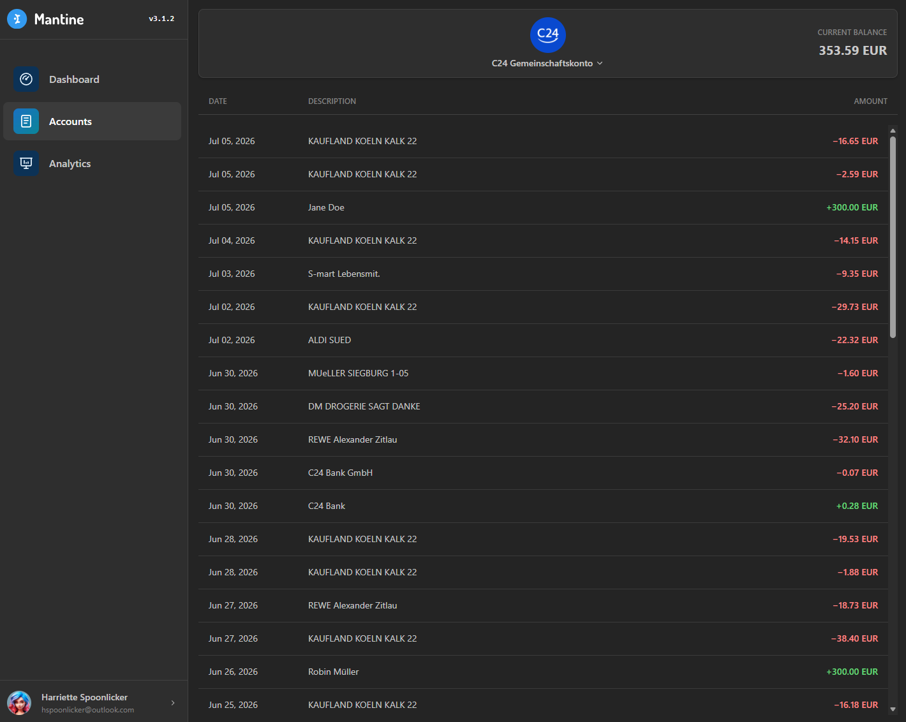

# PersonalFinanceDashboard

PersonalFinanceDashboard is the working title of this project which is intended to be a dashboard to track one's personal finances. The idea is to be able to track bank accounts, credit cards, investments and similar assets through one single application. I plan to include tools for budgeting, analyzing spending habits, and tracking investments.

## Development Status

This project is in an early development stage and not yet ready for use ;)

## Why another personal finance app?

I grew a little dissatisfied with the personal finance apps I have used so far. Either they are too complex, have horrible UX or simply lack features. While building such an app will be a lot of work, and will most likely take a lot of time, I want to challenge myself and see if I can build something that I would actually use myself.

## Progress

Here is a very early impression of the application. Keep in mind that most of what you see is nowhere near a finished state:



## Getting started

The repository contains the server (`src/server`, .NET with a GraphQL API) and the client (`src/client`, React with
Mantine UI). Bank data is retrieved through [GoCardless Bank Account Data](https://gocardless.com/bank-account-data/).

### Prerequisites

- The [.NET SDK](https://dotnet.microsoft.com/download) in the version set in `global.json` (10.0.404 or a later
  patch)
- [Node.js](https://nodejs.org/) in the version set in `src/client/.nvmrc` (24)
- A GoCardless Bank Account Data account, for the secret ID and key of its API. They're created under "User secrets"
  in the GoCardless portal.
- Optionally [Docker](https://www.docker.com/), to collect logs with Seq or to [deploy](./deployment/README.md) the
  dashboard

### Server

Store the GoCardless keys as user secrets:

```shell
cd src/server
dotnet user-secrets set "AppConfiguration:GoCardlessConfiguration:SecretId" "<secret id>" --project RobinTTY.PersonalFinanceDashboard.API
dotnet user-secrets set "AppConfiguration:GoCardlessConfiguration:SecretKey" "<secret key>" --project RobinTTY.PersonalFinanceDashboard.API
```

Then restore the .NET tools (Entity Framework and the formatter) and start the API:

```shell
dotnet tool restore
dotnet run --project RobinTTY.PersonalFinanceDashboard.API
```

The GraphQL API runs at http://localhost:5115/graphql, which also serves an IDE for queries when opened in a browser.
The SQLite database (`PersonalFinanceDashboard.db` next to the API project) is created and migrated on startup.

In development, logs are also sent to Seq at http://localhost:5341. Start it with
`docker compose -f deployment/docker-compose.yml up -d`, its UI is at http://localhost:8001. While Seq isn't
running, logs are written to `logs/` in the API project instead.

### Client

```shell
cd src/client
npm ci
npm run dev
```

The dashboard runs at http://localhost:5173 and talks to the API set as `VITE_API_URL` in
`src/client/env-settings/.env`.

To run the client without the server, use the mocked API: add `VITE_ENABLE_API_MOCKING=true` to
`src/client/env-settings/.env.local` and restart `npm run dev`. The responses come from `src/client/src/mocks`.

### GraphQL types

The client's types in `src/client/src/graphql/types` are generated from the client's queries and the API's schema,
which is committed as `src/client/src/graphql/schema.graphql`. After changing the schema, export it and regenerate
the types. After changing a query, only regenerate the types:

```shell
cd src/client
npm run graphql-schema-export
npm run graphql-types-generate
```

The export builds the API, but doesn't need it running or touch its database.

### Tests and checks

These are the checks CI runs:

| Part | Command (in `src/server` or `src/client`) |
| --- | --- |
| Server tests | `dotnet test --configuration Release` |
| Server formatting | `dotnet jb cleanupcode RobinTTY.PersonalFinanceDashboard.sln --profile="Built-in: Reformat Code" --no-build` |
| Missing migrations | `dotnet ef migrations has-pending-model-changes --project RobinTTY.PersonalFinanceDashboard.Infrastructure --startup-project RobinTTY.PersonalFinanceDashboard.API` |
| Client tests | `npm test` |
| Client lint and formatting | `npm run lint`, `npm run prettier` |
| Client types | `npm run typecheck` |
| Schema and generated types up to date | `npm run graphql-schema-export`, `npm run graphql-types-generate`, then no changes in `git diff` |

A pre-push hook formats the server code before pushing, like CI checks it. Enable it once with `git config core.hooksPath .githooks`.

See [CONTRIBUTING.md](./CONTRIBUTING.md) for the conventions of the code base.
